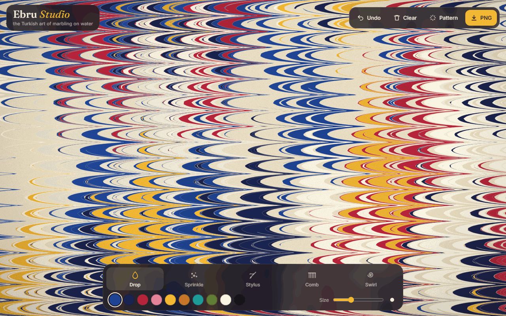

# Ebru Studio

Drop paint on water, pull it with a stylus or a comb, and make your own **ebru** — the Turkish art of paper marbling — right in the browser. Save the result as a PNG.

**Live:** https://ardazeybek-dev.github.io/ebru-studio/



## What you can do

| Tool | Turkish | What it does |
|---|---|---|
| Drop | *damla* | Tap to drop paint. Hold to let it keep spreading. Every new drop pushes the older paint outwards, just like on real size (thickened water). |
| Sprinkle | *serpme* | Scatters a handful of small drops around the tap. |
| Stylus | *biz* | Drag to pull thin threads of paint. |
| Comb | *tarak* | Drag a comb of parallel tines through the whole tray. |
| Swirl | *girdap* | Hold to turn the paint into a spiral. |

**Pattern** builds a classic design step by step — *taraklı* (combed), *şal* (shawl), *bülbül yuvası* (nightingale's nest), *hatip* and *gel-git* (back and forth) — in a random palette. You can keep painting on top of it.

Keyboard: `1`–`5` tools · `Z` undo · `R` pattern · `C` clear · `S` save PNG. Works with touch on phones.

## How it works

Every drop of paint is a closed polygon. Tools never paint pixels; they **move polygon points** with exact, area-preserving formulas:

- **Drop** at centre `C` with radius `r`: `P' = C + (P − C) · √(1 + r² / |P − C|²)`
- **Stylus / comb**: points near a tine slide along the stroke by `z · e^(−d/λ)` (`d` = distance to the nearest tine). Long strokes are split into short steps so curves never fold over.
- **Swirl**: every ring around the centre turns rigidly, inner rings faster.

After each step, long edges are split and tiny ones merged, so the curves stay smooth; a vertex budget keeps the frame rate steady when the paint gets very stretched. A growing drop's centre is carried by the flow too, so neighbouring drops push each other naturally.

The math follows Aubrey Jaffer's and Shufelt's work on *mathematical marbling*.

## Run locally

It is a single HTML file with no build step and no dependencies.

```bash
git clone https://github.com/ardazeybek-dev/ebru-studio.git
cd ebru-studio/docs
python -m http.server 8000
# open http://localhost:8000
```

No environment variables are needed.

## Project structure

```
ebru-studio/
├── docs/
│   ├── index.html   # the whole app (HTML + CSS + JS, Canvas 2D)
│   └── preview.png  # screenshot used above
└── README.md
```

GitHub Pages serves the `docs/` folder of `main`.

## Pitfalls

- A paint drop stays tiny instead of spreading → nearby drops moved its centre while it was still growing → track the centre as a point that every transform also moves.
- A fast flick with the stylus or comb does nothing → the pointer was released before the next animation frame processed the path → apply the pending path on `pointerup` too.
- Strokes fold paint over itself (jagged overlaps) → one big displacement step is steeper than the fall-off → split each stroke into steps no longer than about half the fall-off length.
